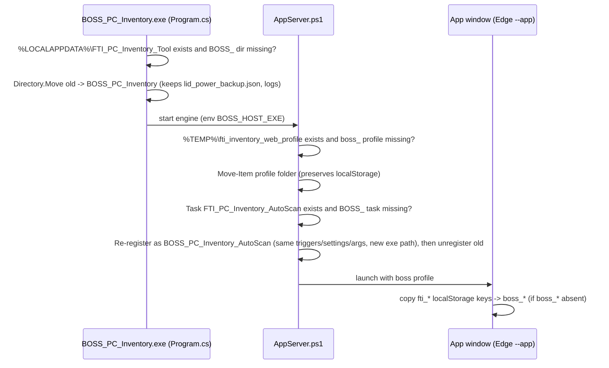

# Rebrand: FTI PC Inventory Tool → BOSS PC Inventory

## Goal
Rename the product to **BOSS PC Inventory** everywhere it is user-visible or produced by the build, and migrate persisted runtime identifiers so existing installs upgrade seamlessly — no lost settings, no orphaned scheduled task, no certificate reinstall.

### Decisions (from interview)
| Topic | Decision |
|---|---|
| New name | **BOSS PC Inventory** · exe `BOSS_PC_Inventory.exe` |
| Scope | Display text + assembly metadata + build artifacts + runtime IDs **with one-time auto-migration** |
| Signing cert | **Keep** `CN=Function International (FTI)` (publisher identity) → no reinstall on client PCs |
| Repo / workspace folder | **Unchanged** (`e:\WEB\FTI_PC_Inventory_Tool`, GitHub `FTI_PC_Inventory_Tool`) |
| Demo data | **Unchanged** (`FTI-PC-001`, `@fti.co.th`) |

## User Review Required

> [!IMPORTANT]
> **Publisher identity stays "Function International (FTI)".** Because the cert is kept, `AssemblyCompany`, `AssemblyCopyright`, and the cert-installer banner continue to say *Function International*. Only the **product** name becomes BOSS. Windows file Properties will show *Product: BOSS PC Inventory · Company: Function International (FTI)*.

> [!WARNING]
> **Existing shortcuts / deploy scripts pointing at `FTI_PC_Inventory.exe` will break.** `build.ps1` will delete the stale `dist\FTI_PC_Inventory.exe` and `%LOCALAPPDATA%\FTI_PC_Inventory_Tool\dist\FTI_PC_Inventory.exe` so nobody keeps launching an outdated build. The scheduled task is migrated automatically (see §2).

> [!NOTE]
> `GEMINI.md` (your rules file) references `dist/FTI_PC_Inventory.exe`. I will update those path references to `dist/BOSS_PC_Inventory.exe` so the post-build rules keep matching reality. Rule semantics are unchanged.

---

## Proposed Changes

### Migration flow (runs once, automatically, on first launch of the new exe)



All migration steps are **idempotent**, **non-destructive on failure** (wrapped in try/catch, logged via `Write-SystemLog`), and only act when the old item exists **and** the new one does not.

---

### 1. Native launcher

#### [MODIFY] [Program.cs](file:///e:/WEB/FTI_PC_Inventory_Tool/src/host/Program.cs)
```diff
-[assembly: AssemblyTitle("FTI PC Inventory Tool")]
-[assembly: AssemblyDescription("Function International - Enterprise PC Hardware and Software Inventory Scanner")]
+[assembly: AssemblyTitle("BOSS PC Inventory")]
+[assembly: AssemblyDescription("BOSS PC Inventory - Enterprise PC Hardware and Software Inventory Scanner")]
 [assembly: AssemblyCompany("Function International (FTI)")]      // kept (publisher)
-[assembly: AssemblyProduct("FTI PC Inventory Tool")]
-[assembly: AssemblyTrademark("FTI")]
+[assembly: AssemblyProduct("BOSS PC Inventory")]
+[assembly: AssemblyTrademark("BOSS")]
-namespace FTI.PCInventory
+namespace Boss.PCInventory
```
- Introduce constants `AppDirName = "BOSS_PC_Inventory"`, `LegacyAppDirName = "FTI_PC_Inventory_Tool"` and replace the 4 hard-coded `"FTI_PC_Inventory_Tool"` literals (lines 31, 34, 191, 334).
- New `MigrateLegacyAppDir(localAppData)` called first in `Main`: if legacy dir exists and new dir doesn't → `Directory.Move`; if both exist → move only `lid_power_backup.json` when the new one lacks it.
- `RestoreLidActionFallback` additionally checks the legacy dir, so a backup left by an old build is still restored.
- Manifest resource `"FTI.Engine"` → `"Boss.Engine"`; env var `FTI_HOST_EXE` → `BOSS_HOST_EXE`.

#### [MODIFY] [app.manifest](file:///e:/WEB/FTI_PC_Inventory_Tool/src/host/app.manifest)
`name="FTI.PCInventory.Launcher"` → `name="Boss.PCInventory.Launcher"`.

---

### 2. Backend engine

#### [MODIFY] [AppServer.ps1](file:///e:/WEB/FTI_PC_Inventory_Tool/src/AppServer.ps1)
- **Identifiers**: `FTI.PowerManager` → `Boss.PowerManager` (namespace in `Add-Type`), mutex `Local\BOSS_PC_Inventory_MasterCsvMutex`, header `X-BOSS-Token`, meta `boss-api-token`, `Get-FtiExecutablePath` → `Get-BossExecutablePath`, `Get-FtiWinTaskInfo` → `Get-BossWinTaskInfo`, temp file prefix `boss_quick_targets_`, log prefix `[BOSS Inventory]`, `"BOSS Backend Engine"`.
- **Exe lookup** (`Get-BossExecutablePath`): honor `$env:BOSS_HOST_EXE`, then search `BOSS_PC_Inventory.exe` in the same candidate dirs (with `%LOCALAPPDATA%\BOSS_PC_Inventory\dist\`).
- **Task name**: constant `$script:TaskName = 'BOSS_PC_Inventory_AutoScan'`, `$script:LegacyTaskName = 'FTI_PC_Inventory_AutoScan'`; replace all 8 literals.
- **[NEW] `Invoke-LegacyMigration`** (called once at startup, before the HTTP listener):
  ```powershell
  # Browser profile (holds localStorage)
  $oldProf = Join-Path $env:TEMP 'fti_inventory_web_profile'
  $newProf = Join-Path $env:TEMP 'boss_inventory_web_profile'
  if ((Test-Path $oldProf) -and -not (Test-Path $newProf)) { Move-Item $oldProf $newProf }

  # Scheduled task
  $old = Get-ScheduledTask -TaskName $script:LegacyTaskName -ErrorAction SilentlyContinue
  $new = Get-ScheduledTask -TaskName $script:TaskName -ErrorAction SilentlyContinue
  $exe = Get-BossExecutablePath
  if ($old -and -not $new -and $exe) {
      $args   = $old.Actions[0].Arguments            # keeps -Silent -OutDir "..."
      $action = New-ScheduledTaskAction -Execute $exe -Argument $args
      Register-ScheduledTask -TaskName $script:TaskName -Action $action `
          -Trigger $old.Triggers -Principal $old.Principal -Settings $old.Settings -Force | Out-Null
      Unregister-ScheduledTask -TaskName $script:LegacyTaskName -Confirm:$false
  }
  ```
  Each block in its own try/catch; outcome logged (`INFO Migrated ...` / `WARN Migration skipped: ...`).
- Lid backup path → `%LOCALAPPDATA%\BOSS_PC_Inventory\lid_power_backup.json`.

#### [MODIFY] [Get-PCInventory.Core.ps1](file:///e:/WEB/FTI_PC_Inventory_Tool/src/Get-PCInventory.Core.ps1)
Header comment + mutex name (must match AppServer: `Local\BOSS_PC_Inventory_MasterCsvMutex`).

#### [MODIFY] [Gui.ps1](file:///e:/WEB/FTI_PC_Inventory_Tool/src/Gui.ps1)
Window caption / title label / header comment → `BOSS PC Inventory`.

---

### 3. Web UI

#### [MODIFY] [index.html](file:///e:/WEB/FTI_PC_Inventory_Tool/src/web/index.html)
- `<title>`, `.brand-badge` title, `.brand-title`, `[Ready]` log line, restart-confirm dialog → `BOSS PC Inventory`.
- API token: `meta[name="boss-api-token"]`, `BOSS_API_TOKEN`, header `X-BOSS-Token`.
- localStorage keys `fti_*` → `boss_*` (`chart_types`, `theme`, `quick_recent`, `quick_presets`, `col_widths_hw`, `col_widths_sw`).
- **[NEW] one-time key migration** at the top of the main script (before any `localStorage.getItem`):
  ```js
  (function migrateLegacyStorage() {
    try {
      const keys = ['chart_types','theme','quick_recent','quick_presets','col_widths_hw','col_widths_sw'];
      keys.forEach(k => {
        const oldV = localStorage.getItem('fti_' + k);
        if (oldV !== null && localStorage.getItem('boss_' + k) === null) {
          localStorage.setItem('boss_' + k, oldV);
        }
      });
    } catch (e) {}
  })();
  ```
  Old `fti_*` keys are left in place (harmless, allows rollback to an older build).

---

### 4. Build pipeline & artifacts

#### [MODIFY] [build.ps1](file:///e:/WEB/FTI_PC_Inventory_Tool/build.ps1)
- Banner/comments, `<title>` injection → `BOSS PC Inventory`.
- `$ExeName` default `BOSS_PC_Inventory.exe`; temp build exe `BOSS_PC_Inventory_Build.exe`; temp dir `BOSS_Inventory_Build`; icon `boss_inventory.ico`; csc resource `Boss.Engine`.
- Output: `dist\BOSS_PC_Inventory.exe`, `dist\BOSS_Enterprise_Certificate.cer`, `Install_Certificate.bat` text updated (publisher line unchanged).
- AppData deploy → `%LOCALAPPDATA%\BOSS_PC_Inventory\dist\`.
- **Cleanup stale legacy outputs**: `Remove-Item` (SilentlyContinue) `dist\FTI_PC_Inventory.exe`, `dist\FTI_Enterprise_Certificate.cer`, `%LOCALAPPDATA%\FTI_PC_Inventory_Tool\dist\FTI_PC_Inventory.exe`.
- `$certSubject` stays `CN=Function International (FTI)`.

#### [MODIFY] [run.bat](file:///e:/WEB/FTI_PC_Inventory_Tool/run.bat)
Title/banner; `taskkill` both `BOSS_PC_Inventory.exe` and legacy `FTI_PC_Inventory*.exe`; launch path `%LOCALAPPDATA%\BOSS_PC_Inventory\dist\BOSS_PC_Inventory.exe`.

#### [MODIFY] [.gitignore](file:///e:/WEB/FTI_PC_Inventory_Tool/.gitignore)
Add `dist/BOSS_PC_Inventory*.exe`, `boss_inventory_web_profile/` (keep legacy FTI lines).

#### [MODIFY] `dist/Install_Certificate.bat` · [DELETE] `dist/FTI_Enterprise_Certificate.cer` · [NEW] `dist/BOSS_Enterprise_Certificate.cer`
Regenerated by `build.ps1` (same certificate bytes, new filename).

---

### 5. Tooling & docs

#### [MODIFY] `tools/test-scheduler.ps1`, `tools/test-environment.ps1`, `tools/analyze.ps1`, `tools/make-icon.ps1`
Exe/task/dir names and banners → BOSS (test task `BOSS_PC_Inventory_AutoScan_Test`).

#### [MODIFY] `README.md`, `GEMINI.md`, `PSScriptAnalyzerSettings.psd1`, `push_to_github.bat`
Product name + exe/AppData paths. GitHub URL in `push_to_github.bat` and the `FTI_PC_Inventory_Tool/` folder tree in README stay as-is (repo not renamed).

**Not touched**: `docs/superpowers/plans/*`, `chat_memory_export/*`, the Thai-named notes file (historical records), demo data generator.

---

## Verification Plan

### Automated
1. **No stray product-name references**:
   `git grep -n -I -E "FTI PC Inventory|FTI_PC_Inventory\.exe|FTI_PC_Inventory_AutoScan|X-FTI-Token|fti-api-token|FTI_HOST_EXE|FTI\.Engine|fti_(theme|chart_types|quick_|col_widths)"` → only allowed hits: legacy-migration constants, `.gitignore` legacy lines, historical docs.
2. **Migration unit test** (scratch PS script, isolated temp dirs + throwaway task `BOSS_MigTest_*`): seed legacy profile folder + legacy task → run `Invoke-LegacyMigration` → assert new folder exists/old gone, new task has identical triggers & arguments with new exe path, old task removed; re-run → no-op.
3. **JS**: `node` syntax check of all `<script>` blocks + localStorage migration test in headless Edge (seed `fti_theme=dark` → reload → `boss_theme === 'dark'`), multi-viewport `1440/750/420`, `fatalJsBanner` absent, header text = `BOSS PC Inventory`.
4. **Build**: `powershell -ExecutionPolicy Bypass -File .\build.ps1` → `dist\BOSS_PC_Inventory.exe` produced, legacy exe removed; `Get-AuthenticodeSignature` shows signer `CN=Function International (FTI)`; `(Get-Item dist\BOSS_PC_Inventory.exe).VersionInfo.ProductName -eq 'BOSS PC Inventory'`.
5. Commit `refactor(brand): vX - rebrand to BOSS PC Inventory with legacy migration` and push to `origin main` per GEMINI.md.

### Manual (please check after I finish)
1. Close any running FTI/BOSS instance, launch `dist\BOSS_PC_Inventory.exe`.
2. Header shows **BOSS PC Inventory**; your theme and Quick Target presets are still there.
3. Task Scheduler: `BOSS_PC_Inventory_AutoScan` present with your original schedule; `FTI_PC_Inventory_AutoScan` gone.
